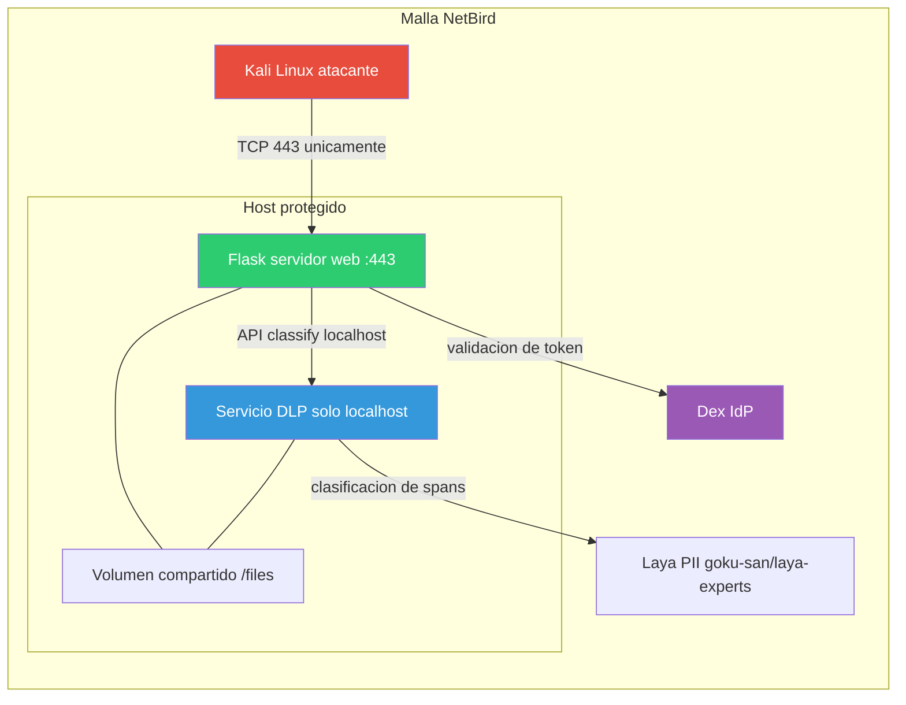
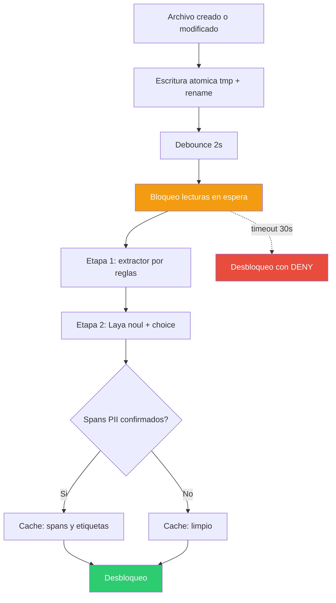
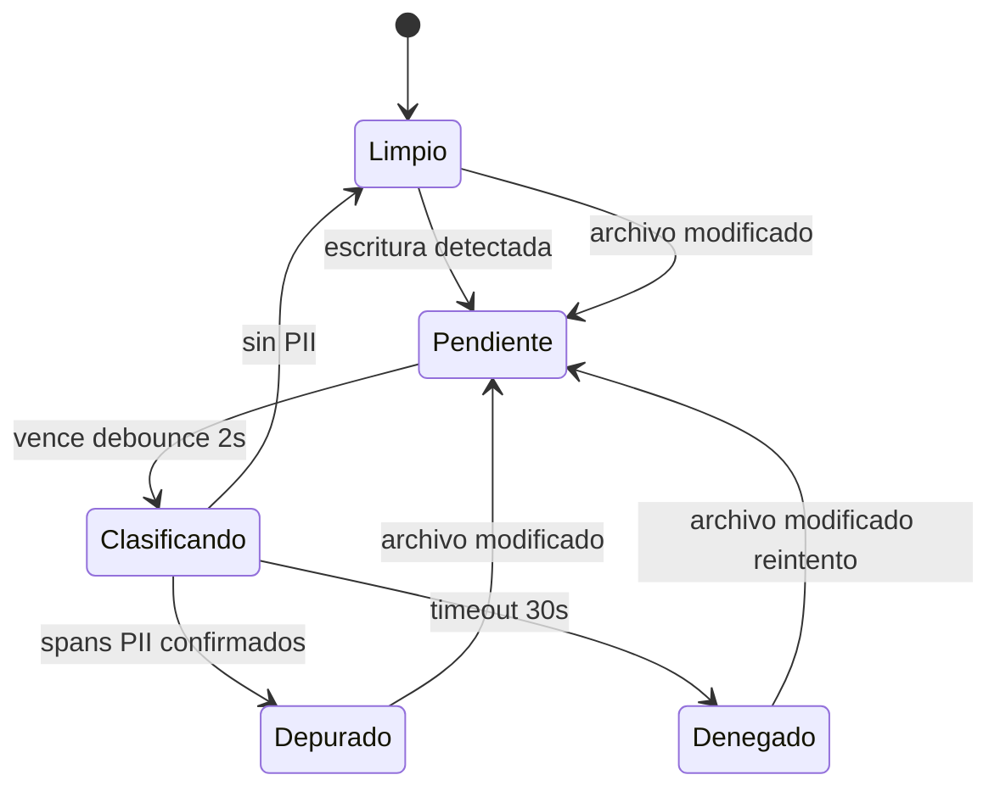
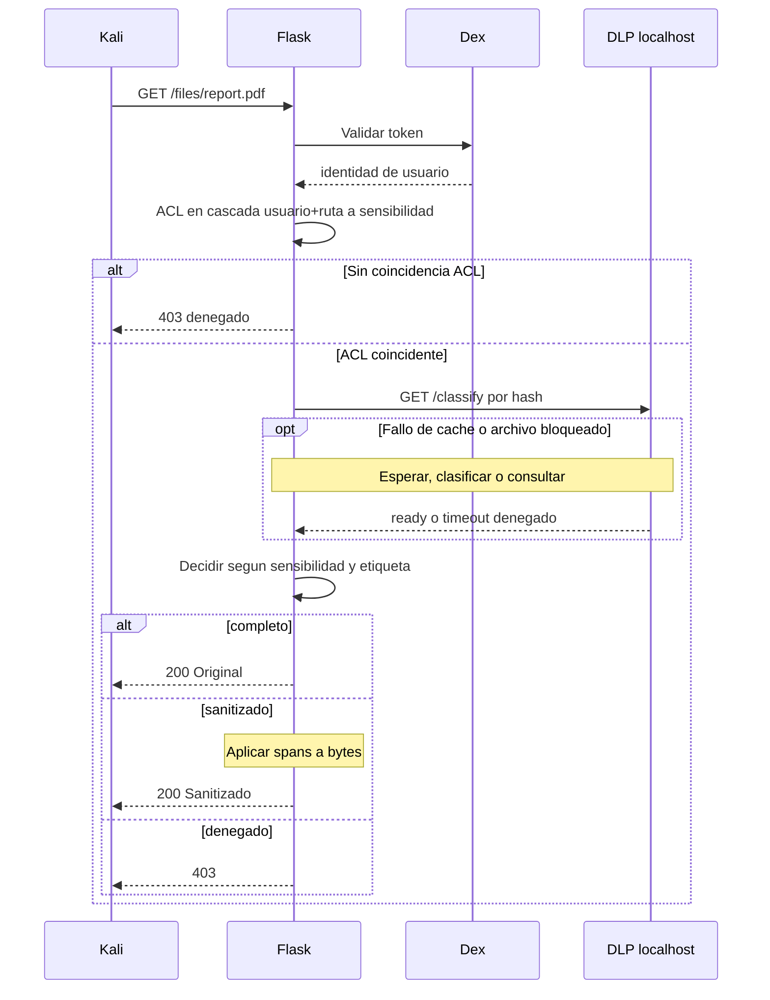

# Implementación de sistema DLP con clasificador Laya

**Universidad de Lima** — Facultad de Ingeniería — Carrera de Ingeniería de Sistemas  
**Curso:** Ciberseguridad · Sección 757 · Grupo 9  
**Integrantes:** Daniel Rolando Vásquez Miontes · Erick Adrian Rios Silva · Rodrigo Salazar Simoni · Escobar Leaño Luis Felipe

---

## 1. Resumen

Compartir o descargar un archivo equivocado puede exponer información que debía permanecer dentro de la organización. El mismo riesgo aparece cuando un colaborador obtiene más datos de los que su autorización permite. Este laboratorio, denominado **DAP Laya**, estudia ese problema en un entorno controlado de ciberseguridad: un nodo atacante (Kali) comparte la malla NetBird con un servidor web protegido, pero solo puede alcanzarlo por TCP/443.

La propuesta combina tres controles. La identidad de usuario proviene de **Dex**. Una **ACL en cascada** mapea `(usuario, ruta) → sensibilidad` (`alta`, `media` o `baja`; gana la ruta más específica). Un servicio de **prevención de fuga de datos (DLP)** clasifica el contenido con reglas y con **Laya** (`goku-san/laya-experts`), y expone etiquetas y fragmentos (spans) de PII mediante una API estrictamente local. El servidor web decide la respuesta:

| Decisión | Efecto |
|----------|--------|
| **completo** | HTTP 200 con el archivo original |
| **sanitizado** | HTTP 200 con los spans de PII reemplazados |
| **denegado** | HTTP 403 |

El aporte del proyecto es demostrar, de forma verificable, cómo la clasificación de contenido sensible se combina con control de acceso por sensibilidad de ruta bajo condiciones realistas de bloqueo, debounce, tiempo de espera, caché indexada por hash y recuperación por lotes.

**Palabras clave:** prevención de fuga de datos, DLP, Laya, Dex, NetBird, PII, control de acceso, sanitización.

## 2. Objetivos

### 2.1 Objetivo general

Implementar y evaluar un prototipo DLP que clasifique contenido sensible con Laya y condicione la descarga de archivos según la sensibilidad autorizada del usuario sobre cada ruta.

### 2.2 Objetivos específicos

1. Preparar un repositorio sintético con documentos públicos y con PII (texto, CSV, PDF y afines). El diseño del corpus (firma ficticia Andes Advisory S.A.C., árbol, manifiesto y plantillas) está en [`data/CORPUS.md`](data/CORPUS.md).
2. Implementar clasificación en dos etapas (reglas + Laya) con caché por hash de contenido.
3. Integrar Dex y una ACL en cascada `(usuario, ruta) → sensibilidad`.
4. Entregar versiones sanitizadas cuando la sensibilidad sea insuficiente para el contenido completo, sin modificar el original en disco.
5. Evaluar el sistema con cinco casos de estudio (autorización, sanitización, latencia de caché/lotes, matriz de decisión y falsos positivos).

## 3. Alcance y supuestos

- El repositorio solo es accesible a través del servidor Flask en el puerto 443.
- Flask y el servicio DLP cohabitan en el **mismo host**, con un volumen de archivos compartido.
- El DLP escucha **únicamente en localhost**; no se publica en la malla ni hacia Kali.
- La política NetBird permite Kali → servidor web solo en TCP/443.
- El corpus es sintético (véase [`data/CORPUS.md`](data/CORPUS.md) y `data/manifest.json`); las conclusiones no se extrapolan a un entorno empresarial real.
- `Informe.docx` es una instantánea histórica del diseño inicial y no se actualiza con este documento.

## 4. Arquitectura de red

Los nodos comparten una malla NetBird. En el host protegido corren dos procesos: el servidor web Flask (`:443`) y el servicio DLP (localhost). Ambos leen el mismo árbol de archivos. Flask valida tokens en Dex y consulta al DLP local para clasificación. El DLP invoca a Laya para confirmar spans de PII.



## 5. Amenaza y superficie de ataque

| Elemento | Tratamiento |
|----------|-------------|
| Kali en la malla | Simula un intruso con conectividad NetBird; solo puede hablar con el servidor en 443 |
| Puerto 443 | Única superficie de descarga expuesta al atacante |
| API DLP | Enlazada a loopback; inaccesible desde Kali y desde otros peers |
| Dex / Laya | Consumidos por el host protegido; no son el punto de entrada de descarga |

El laboratorio ejercita decisiones de autorización y clasificación bajo esa restricción de red, no un perímetro empresarial completo.

## 6. Identidad y autorización

| Componente | Función |
|------------|---------|
| Dex | Identidad del usuario (token → usuario) |
| ACL en cascada | `(usuario, ruta) → sensibilidad` (`alta` \| `media` \| `baja`); gana la coincidencia de ruta más larga/específica; sin coincidencia → denegado |
| Caché DLP | Clave = hash de contenido → etiqueta del archivo + spans de PII |
| Decisión | `salida = f(sensibilidad, etiqueta) → completo \| sanitizado \| denegado` |

La ACL reside y se evalúa en el **servidor web**. Dex no almacena la ACL; el DLP no aplica autorización.

### 6.1 Matriz de decisión

| Estado del archivo | alta | media | baja |
|--------------------|------|-------|------|
| limpio | completo | completo | completo |
| con PII | completo | sanitizado | denegado |

### 6.2 Respuestas HTTP

| Salida | Respuesta |
|--------|-----------|
| completo | 200, archivo original |
| sanitizado | 200, spans de PII reemplazados (original en disco intacto) |
| denegado | 403 |

## 7. Servidor web y servicio DLP

| Proceso | Responsabilidades | Fuera de alcance |
|---------|-------------------|------------------|
| Flask `:443` | TLS, validación Dex, ACL en cascada, decisión `f`, servir o reescribir bytes, registro de auditoría | Laya, vigilancia de archivos, bloqueo, debounce, caché KV, lotes |
| DLP solo localhost | Vigilancia del volumen compartido, debounce 2 s, bloqueo + DENY a 30 s, reglas luego Laya, caché por hash, lotes de recuperación, API de clasificación | Identidad, ACL, HTTP hacia Kali |

### 7.1 API DLP (localhost)

- `GET /classify?path=…` o `GET /classify?hash=…` → `{status, hash, label, spans, laya_version, …}` con `status` ∈ `ready` \| `locked` \| `denied_timeout` \| `missing`
- Ganchos opcionales de invalidación / lotes para recuperar archivos no clasificados mientras el DLP estuvo inactivo
- Sin Dex ni ACL en esta API; enlace exclusivo a loopback

### 7.2 Ruta de una solicitud

1. Flask valida el token Dex y resuelve `(usuario, ruta) → sensibilidad` (sin coincidencia → 403).
2. Flask calcula el hash del archivo y llama a `GET /classify` en localhost.
3. Si `locked`, espera o consulta de nuevo hasta `ready` o hasta agotar el tiempo → denegado.
4. Si `ready`, calcula `f(sensibilidad, etiqueta)`.
5. Si la salida es sanitizado, Flask aplica los `spans` sobre los bytes y responde 200.
6. Flask escribe el registro de auditoría.

## 8. Clasificación de archivos

La clasificación se ejecuta de forma asíncrona al crear o modificar un archivo. La escritura es atómica (temporal + renombrado); a continuación un **debounce de 2 s** agrupa ráfagas de edición. Mientras clasifica, el archivo queda **bloqueado**: los lectores esperan. Un **tiempo máximo de 30 s** libera el bloqueo con marca de denegación.

**Etapa 1:** extractor de candidatos por reglas.  
**Etapa 2:** Laya (noul + choice) por cada span candidato.  
Los resultados se guardan en una caché KV indexada por **hash** de contenido (un cambio de hash invalida la entrada). Si hay PII confirmada se almacenan spans y etiquetas; si no, el archivo se marca limpio.

Un **proceso por lotes** reclasifica archivos omitidos mientras el DLP estuvo inactivo (recuperación / reducción de arranque en frío).



### 8.1 Máquina de estados del archivo

Cada archivo rastrea su estado de clasificación. Una escritura lo pasa a Pendiente; tras el debounce entra en Clasificando. Los desenlaces son Limpio, Depurado (spans confirmados) o Denegado (timeout). Cualquier modificación posterior vuelve a Pendiente.



## 9. Secuencia de solicitud

Ante `GET /files/...`, Flask valida Dex, resuelve la ACL, calcula el hash y consulta al DLP local. Un archivo bloqueado retiene la petición hasta el resultado o el timeout (`denegado`). Un fallo de caché dispara clasificación bajo las mismas reglas de bloqueo. Flask decide `f(sensibilidad, etiqueta)` y, si corresponde, reescribe bytes con los spans del DLP.



## 10. Observabilidad

Cada solicitud genera un registro de auditoría **sin** incluir el contenido sensible del archivo:

| Campo | Significado |
|-------|-------------|
| id de solicitud | Identificador único del intento de descarga |
| tiempo | Marca temporal |
| usuario | Identidad Dex |
| id de archivo + hash | Ruta/id y hash usado en la caché |
| versión de Laya | Build/versión que produjo la etiqueta |
| etiqueta de archivo | limpio \| con PII (detalle de spans en caché, no en la línea de auditoría) |
| sensibilidad ACL | alta \| media \| baja |
| decisión | completo \| sanitizado \| denegado |
| espera de bloqueo | Tiempo en espera por clasificación en curso |
| acierto/fallo de caché | Si el hash ya estaba en la KV |
| duración de clasificación | Tiempo de clasificar ante fallo de caché o clasificación en vivo |

## 11. Casos de estudio

Cinco casos ejercitan la matriz de decisión, la caché y la precisión del clasificador. Los usuarios son identidades Dex con sensibilidad de ACL en cascada (`alta` / `media` / `baja`).

| # | Caso | Preparación | Resultado esperado |
|---|------|-------------|--------------------|
| 01 | Acceso a documento sensible | Archivo con PII; solicitante con sensibilidad `baja` en esa ruta | **denegado** (403); la clasificación condiciona el acceso aunque la ruta parezca abierta |
| 02 | Prevención de PII de clientes | CSV/PDF con PII de clientes; solicitante con `media` | **sanitizado** — spans reemplazados; original intacto |
| 03 | Acceso rápido tras DLP | ~100 archivos sintéticos; caché fría vs. tras vigilancia/lotes; luego modificar un archivo | Latencia de **acierto** menor que la de fallo; cambio de hash invalida; los lotes recuperan omisiones offline |
| 04 | Completo vs. sanitizado vs. denegado | Mismo archivo con PII pedido como `alta`, `media` y sin ACL / `baja` | `alta` → **completo**; `media` → **sanitizado**; `baja`/sin coincidencia → **denegado**; reutilizar caché no omite la ACL |
| 05 | Uso legítimo y falsos positivos | ~80 archivos públicos limpios con códigos de producto, teléfonos corporativos o términos como «proyección» | Todos → **completo** para cualquier sensibilidad; sin sanitizar ni denegar por error; ilegibles/corruptos se registran aparte, no como PII |

## 12. Servidor web (Flask) y Docker

Código en `src/webserver/`. Imagen autocontenida en `docker/Dockerfile` (incluye `data/files/`, `data/manifest.json` y la ACL por defecto). UI mínima: **htmx 4 + Alpine.js + Tailwind CDN**.

### UI y OIDC

1. `GET /` — landing; **Sign in with NetBird** → `GET /auth/login` (PKCE) → Dex en `DEX_ISSUER` → `GET /auth/callback` → cookie `dlp_session`.
2. `GET /browse` — explorador de todo `FILES_ROOT`; carpetas vía HTMX; descargas con `hx-swap="none"` (hx-download solo si `Content-Disposition: attachment`) y toasts Alpine. Barra global de progreso DLP + glifos por archivo (`/api/dlp/progress`, `/api/dlp/statuses`); el lote de arranque (`DLP_BATCH_ON_START`) rellena la caché.
3. `GET /files/<ruta>` acepta **Bearer JWT** o **cookie de sesión**.

Registra un cliente OIDC confidencial con redirect `OIDC_REDIRECT_URI` (p. ej. `https://localhost:8443/auth/callback`). Plantilla: `docker/.env.example`.

### Pipeline `GET /files/<ruta>`

1. Identidad: Bearer Dex o sesión; `preferred_username` / `email` debe coincidir con claves ACL (`ana.alta@knowsyn.dev`, …).
2. ACL en cascada → `alta` | `media` | `baja` (sin match → 403).
3. DLP en el mismo contenedor (`CLASSIFY_MODE=dlp`) o stub del manifiesto (`CLASSIFY_MODE=stub`).
4. Matriz §6.1; si `sanitizado`, reescribe spans (disco intacto).
5. Auditoría JSON (sin cuerpo ni spans).

`GET /healthz` no requiere autenticación. Tests automatizados minten JWT / cookie; no llaman a NetBird en vivo.

### Variables de entorno

| Variable | Rol |
|----------|-----|
| `DEX_ISSUER` / `DEX_CLIENT_ID` | Obligatorias |
| `DEX_CLIENT_SECRET` / `OIDC_REDIRECT_URI` | Login browser (PKCE) |
| `SESSION_SECRET` | Firma de cookie de sesión |
| `DEX_JWKS_URL` | Opcional (por defecto `{issuer}/keys`) |
| `CLASSIFY_MODE` | `stub` (manifiesto, default) o `dlp` (daemon localhost en la misma imagen) |
| `DLP_URL` | Base del daemon (`http://127.0.0.1:8091` si `dlp` y no se define) |
| `DLP_PORT` / `DLP_AUTOSTART` | Puerto loopback y arranque del segundo proceso |
| `DLP_DETECTOR` | `laya` (default) o `rules` (sin pesos; solo lab/tests) |
| `LAYA_*` | `LAYA_DEVICE` (`cuda`/`cpu`), `LAYA_THRESHOLD`, `LAYA_REGION`, `LAYA_CACHE_DIR` (default `/opt/laya-cache`, baked in image) |
| `ENABLE_GPU` | Script local: `1` (default) pasa `--gpus all`; si falla, reintenta en CPU |
| `FILES_ROOT` | Por defecto `/files` |
| `ACL_PATH` / `MANIFEST_PATH` | ACL y manifiesto |
| `TLS_CERT_PATH` / `TLS_KEY_PATH` | Rutas PEM (self-signed al arrancar si faltan; no van en la imagen) |
| `BIND_PORT` | Por defecto `8443` |

### Build y run (local)

Imagen: **`dlp-laya`**. Contenedor local nombrado `dlp-laya` (scripts bajo `scripts/`).

Ejecutar **dentro de WSL** (no desde PowerShell vía `wsl -e …`):

```bash
# Editar docker/.env (ver .env.example), luego:
./scripts/docker-build.sh          # WITH_GPU=1 (default): CUDA torch + pesos Laya horneados
./scripts/docker-start.sh          # https://localhost:8443  (--gpus all si ENABLE_GPU=1)
./scripts/docker-status.sh         # logs + DLP/web health (sin ps/curl en la imagen)
./scripts/docker-attach.sh         # shell en el contenedor
./scripts/docker-stop.sh
# Recrear si cambió .env/imagen: FORCE=1 ./scripts/docker-start.sh
```
Nombre del contenedor: `CONTAINER_NAME` (default `dlp-laya`). No uses la variable `NAME` — WSL la exporta como el nombre del PC Windows.
Los pesos Laya (`goku-san/laya-experts`) se hornean en `/opt/laya-cache` en el build; el arranque ya no descarga de Hugging Face (`HF_HUB_OFFLINE=1`).
GPU: hace falta el runtime NVIDIA en Docker Desktop/WSL (`--gpus all`). Si falla con `CDI: no known GPU vendor found`, actualiza Docker Desktop + `wsl --update`, reinicia Desktop, y prueba `docker run --rm --gpus all nvidia/cuda:12.4.1-base-ubuntu22.04 nvidia-smi`. `docker-start` reintenta en CPU y Laya cae a `LAYA_DEVICE=cpu` (lento en RTX ausente). Certs + caché SQLite DLP: volúmenes `dlp-laya-certs` / `dlp-laya-dlp`. `--restart unless-stopped` por si el daemon reinicia contenedores.
El watcher de ficheros permanece en pausa hasta terminar el lote de arranque (evita invalidar el batch).

`WITH_DLP=0 ./scripts/docker-build.sh` omite torch/laya. `WITH_GPU=0` usa torch CPU. Desarrollo sin Docker (HTTP): `PYTHONPATH=src … python -m webserver` (`COOKIE_SECURE=0`). Tests: `pytest tests/webserver tests/dlp_service`.

### E2E Playwright (caso 04)

Sustituto del intruso Kali para el demo: Chromium inicia sesión real en NetBird/Dex y descarga `casos/caso04_proyecto_mixto.pdf` como `alta` / `media` / `baja`.

```bash
# Contenedor arriba en :8443 y USER_* en docker/.env, luego:
./scripts/e2e-uc04.sh
```

Espera: ana → toast `Descarga (completo)`; bruno → `Descarga (sanitizado)`; carla → 403 `Denegado` (sin ACL en caso04). Variables: `E2E_BASE_URL` (default `https://localhost:8443`).

### Despliegue en VM

`docker/run.sh` es el entrypoint **en el host de despliegue** tras `docker load` del tarball (no el flujo local). Copia el archive + `.env` + `run.sh` y ejecuta `./run.sh` en la VM.

## 13. Limitaciones

Los resultados se limitan al repositorio sintético y a las condiciones del laboratorio NetBird. No se afirma equivalencia con el desempeño, la escala ni la amenaza de un despliegue empresarial. La evaluación de autorización y de clasificación se interpretará frente a etiquetas de referencia definidas por el grupo y frente a los registros de auditoría descritos arriba. El login OIDC real requiere registrar el cliente redirect en NetBird/Dex.

